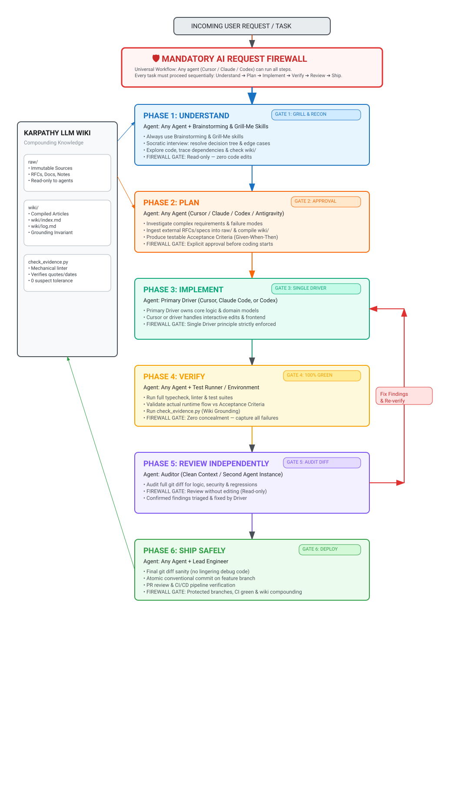

# Multi-Agent AI Engineering Workflow

A pragmatic, battle-tested framework for building software with AI coding agents (Cursor, Claude Code, Codex, and Antigravity). It keeps AI tools from making wild assumptions, writing sloppy code in a hurry, hiding broken tests, or blowing up your architecture.

> 🛡️ **THE REQUEST FIREWALL**: Every request entering this repository stops at the **[Request Firewall](file:///d:/ai%20agent/the-developer/FIREWALL.md)** first:
> 1. **Match with Wiki & Docs First:** If the requested change contradicts existing architecture, ADRs, or wiki knowledge, the firewall blocks execution and returns the contradiction immediately.
> 2. **Sequential Quality Gates:**
>    **1. Understand** ➔ **2. Spec** ➔ **3. Plan** ➔ **4. Implement** ➔ **5. Verify** ➔ **6. Review Independently** ➔ **7. Ship Safely**.

---

## The 7-Phase Lifecycle Diagram

> Open and edit the native drawing with your Excalidraw / ExcelDraw viewer: **[`workflow.exceldraw`](file:///d:/ai%20agent/the-developer/workflow.exceldraw)** (or **[`workflow.excalidraw`](file:///d:/ai%20agent/the-developer/workflow.excalidraw)**).



---

## Universal 7-Phase Lifecycle Matrix

> [!NOTE]
> **Any agent can drive any phase:**
> This workflow isn't split into rigid silos. **Cursor**, **Claude Code**, **Codex**, or **Antigravity** can run all seven phases end-to-end, or collaborate as a team. What matters is following the gates and not cutting corners.

| Phase | Who Runs It | Core Focus | Hard Constraint |
|---|---|---|---|
| **0. Pre-Admission** | Any Agent + Wiki / Docs | Match input against `wiki/` and docs; detect contradictions | Return contradiction or proceed to Phase 1. |
| **1. Understand** | Any Agent + **Brainstorming & Grill-Me** + Wiki | Socratic interview, edge cases, trade-offs, explore code & wiki | **Read-Only**: Zero code edits allowed. |
| **2. Spec** | Any Agent (Cursor / Claude / Codex) + Wiki | Technical & functional contracts: schemas, APIs, invariants (WHAT) | **Read-Only**: Zero source code edits allowed. |
| **3. Plan** | Any Agent (Cursor / Claude / Codex) + Wiki | Implementation roadmap, risk matrix, acceptance criteria (HOW) | No code written until human sign-off on the plan. |
| **4. Implement** | Primary Driver + Parallel Agents | Core logic, implementation loop (`Spec➔Plan➔Impl`), `/find-skills`, parallel dispatch | **Single Driver & Loop Invariant**: Sub-specs required for all streams. |
| **5. Verify** | Any Agent + Test Runner | Automated quality gates, high-risk domain checks, evidence report | **Zero Concealment & Evidence Gate**: Stricter checks on migrations/auth/permissions/payments; 5-point report required. |
| **6. Review Independently** | Auditor (Clean Context / Second Agent) | Full `git diff` audit for bugs, security holes, performance | **Review Without Editing**: Reviewer cannot modify files. |
| **7. Ship Safely** | Any Agent + Engineer | Clean diff check, conventional commits, CI/CD run, compound wiki | Never commit straight to `main` or `master`. |

---

## Humanized Content Standard

All content in this project—code comments, commit messages, PR descriptions, and documentation—must read like it was written by a thoughtful, practical software engineer:
- **No AI Buzzwords:** Ban empty filler like "delve into", "tapestry", "in conclusion", "it's important to remember", "testament to", "harnessing", "streamlining", or "game-changer".
- **Direct & Active Voice:** Speak plainly: "we recommend", "this function throws when...", "here's how to configure".
- **Pragmatic Comments:** Explain *why* something unusual was done, not what the syntax already shows.
- **Natural Engineering Rhythm:** Keep sentences direct, punchy, and grounded in real-world trade-offs.

---

## Repository Rules & Agents Architecture

Rules derived from repository documents (`FIREWALL.md`, `AI_WORKFLOW.md`, `skills/`) and compiled into the Karpathy LLM Wiki (`wiki/`) are active across all coding assistants:

```
the-developer/
├── agents/
│   └── wiki-researcher.md             # Custom Web Researcher agent specification
├── .cursor/
│   ├── agents/
│   │   └── wiki-researcher.md         # Cursor custom subagent (inherit model)
│   ├── commands/
│   │   ├── understand.md              # Cursor /understand command
│   │   ├── spec.md                    # Cursor /spec command
│   │   └── plan.md                    # Cursor /plan command
│   └── rules/
│       ├── workflow.mdc               # Universal 7-phase lifecycle protocol
│       ├── firewall-rules.mdc         # Request Firewall admission controller & contradiction check
│       ├── wiki-rules.mdc             # Karpathy LLM Wiki Grounding Invariant & local cursor projects
│       ├── wiki-researcher.mdc        # Web research & wiki auto-indexing rule
│       └── engineering-standards.mdc  # Single Driver, zero concealment, humanized content rules
├── .cursorrules                       # Root Cursor universal agent instructions
├── .claude/
│   ├── agents/
│   │   └── wiki-researcher.md         # Claude Code custom research agent (sonnet model, cyan color)
│   ├── commands/
│   │   ├── understand.md              # /understand <requirement> command
│   │   ├── spec.md                    # /spec [context] command
│   │   ├── plan.md                    # /plan [context] command
│   │   ├── research.md                # /research <topic or url> command
│   │   └── setup-agent.md             # /setup-agent onboarding command
│   └── rules/
│       ├── firewall.md                # Claude Code firewall admission rules & contradiction gate
│       ├── wiki.md                    # Claude Code wiki Grounding Invariant & procedures
│       ├── workflow.md                # Claude Code 7-phase universal lifecycle
│       └── engineering.md             # Claude Code engineering, humanized prose & diagram rules
├── CLAUDE.md                          # Claude Code master instruction file
├── CODEX.md                           # Codex master universal instructions
├── templates/                         # Phase prompt templates
│   ├── 01-understand.md               # Phase 1 Understand template
│   ├── 02-spec.md                     # Phase 2 Spec template
│   ├── 03-plan.md                     # Phase 3 Plan template
│   ├── 04-implement.md                # Phase 4 Implement template (Single Driver & Loop Gate)
│   ├── 05-verify.md                   # Phase 5 Verify template
│   ├── 06-independent-review.md       # Phase 6 Review template
│   └── 07-ship-safely.md              # Phase 7 Ship Safely template
├── raw/                               # Immutable source documents
│   ├── cursor-projects/               # Local Cursor workspace inventories & transcripts
│   └── workflow/
│       ├── 2026-10-14-ai-workflow-spec.md
│       └── 2026-10-14-firewall-spec.md
└── wiki/                              # Compiled knowledge base
    ├── index.md                       # Global knowledge index
    ├── log.md                         # Append-only operation log
    ├── cursor-projects/
    │   └── local-knowledge-base.md    # Local Cursor projects knowledge reference
    └── workflow/
        ├── universal-workflow.md      # Grounded universal workflow article
        └── request-firewall.md        # Grounded request firewall article
```

---

## Custom Subagents: Wiki Researcher

The **Wiki Researcher** is configured as a dedicated subagent across both **Cursor** ([`.cursor/agents/wiki-researcher.md`](file:///d:/ai%20agent/the-developer/.cursor/agents/wiki-researcher.md)) and **Claude Code** ([`.claude/agents/wiki-researcher.md`](file:///d:/ai%20agent/the-developer/.claude/agents/wiki-researcher.md)). It investigates technical topics on the web, archives source text into `raw/`, and immediately compiles and indexes the researched website into the project wiki.

### How to Run:
- **In Cursor:** Mention `@wiki-researcher <topic or url>` in Composer/Chat.
- **In Claude Code:** Run `/research <topic or url>` or delegate with `@wiki-researcher`.
- **In Antigravity:** Trigger subagent `wiki-researcher`.

---

## Step-by-Step Universal Execution Guide

Every step in this workflow is **agent-universal** (executable by **Cursor**, **Claude Code**, **Codex**, or **Antigravity**). At each step, the agent maintains an **ExcelDraw diagram** (`.exceldraw` / `.excalidraw` / `.svg`) in [`diagrams/`](file:///d:/ai%20agent/the-developer/diagrams/) along with a clear description.

### Pre-Admission: Contradiction Check
1. The agent parses the user's prompt or requirement.
2. The agent matches the requirement against `wiki/index.md`, relevant `wiki/` articles, and project documentation.
3. If the requirement contradicts documented architecture or decisions, execution is **BLOCKED**, and the contradiction is returned immediately.

### Step 1: Understand (Command: `/understand`)
1. Run **`/understand <task description>`** (defined in [`.claude/commands/understand.md`](file:///d:/ai%20agent/the-developer/.claude/commands/understand.md) and [`.cursor/commands/understand.md`](file:///d:/ai%20agent/the-developer/.cursor/commands/understand.md)).
2. The agent executes **Brainstorming** (goals/anti-goals, trade-offs) and **Grill-Me** (Socratic decision-tree questioning).
3. The agent explores the codebase (read-only), checks `wiki/index.md`, and inspects `C:\Users\farooq\.cursor\projects` for prior session transcripts.
4. **Visual Artifact**: Update [`diagrams/01-understand.exceldraw`](file:///d:/ai%20agent/the-developer/diagrams/01-understand.exceldraw) with an architectural context and trade-off description.
5. **Hard Rule**: READ-ONLY. Zero code edits.

### Step 2: Spec (Command: `/spec`)
1. Run **`/spec`** (defined in [`.claude/commands/spec.md`](file:///d:/ai%20agent/the-developer/.claude/commands/spec.md) and [`.cursor/commands/spec.md`](file:///d:/ai%20agent/the-developer/.cursor/commands/spec.md), with template [`templates/02-spec.md`](file:///d:/ai%20agent/the-developer/templates/02-spec.md)).
2. The agent formalizes functional workflows, behavioral invariants, schemas, API contracts, error envelopes, and explicit non-features (the WHAT).
3. Ingest external specs or RFCs into `raw/` and compile them into `wiki/`.
4. **Visual Artifact**: Maintain and describe [`diagrams/02-spec.exceldraw`](file:///d:/ai%20agent/the-developer/diagrams/02-spec.exceldraw).
5. **Hard Rule**: READ-ONLY on source code. Obtain human sign-off on the spec before planning.

### Step 3: Plan (Command: `/plan`)
1. Run **`/plan`** (defined in [`.claude/commands/plan.md`](file:///d:/ai%20agent/the-developer/.claude/commands/plan.md) and [`.cursor/commands/plan.md`](file:///d:/ai%20agent/the-developer/.cursor/commands/plan.md), with template [`templates/03-plan.md`](file:///d:/ai%20agent/the-developer/templates/03-plan.md)).
2. The agent takes the approved spec, investigates tricky implementation details, maps out risks, and writes testable Acceptance Criteria (Given-When-Then).
3. **Visual Artifact**: Generate [`diagrams/03-plan.exceldraw`](file:///d:/ai%20agent/the-developer/diagrams/03-plan.exceldraw) illustrating milestones and acceptance gates.
4. Review and approve the plan before any coding begins.

### Step 4: Implement (Primary Driver & Implementation Loop Gate)
1. Designate the **Primary Driver** (Cursor, Claude Code, or Codex) using [`templates/04-implement.md`](file:///d:/ai%20agent/the-developer/templates/04-implement.md).
2. The Primary Driver owns the core change, domain logic, and unit tests sequentially.
3. **Implementation Loop Gate (`Implement ➔ Loop ➔ Spec ➔ Plan ➔ Implement`)**:
   - If multiple tasks, decoupled sub-modules, or new capabilities emerge, enter the decomposition loop.
   - Run `/find-skills` (or `npx skills find <domain>`) to find and install specialized skills from [skills.sh](https://skills.sh).
   - Dispatch **parallel subagents** for independent sub-tasks (e.g. backend service vs. frontend UI vs. DB migrations).
   - Invariant: Each parallel stream must satisfy its own sub-spec and sub-plan before writing code.
4. If collaborating, secondary agents focus strictly on interactive styling and frontend polish.
5. **Visual Artifact**: Generate [`diagrams/04-implement.exceldraw`](file:///d:/ai%20agent/the-developer/diagrams/04-implement.exceldraw) detailing component wiring, the implementation loop, and parallel agent orchestration.

### Step 5: Verify (Automated Quality Gates & Evidence Completion)
1. Run the verification protocol from [`templates/05-verify.md`](file:///d:/ai%20agent/the-developer/templates/05-verify.md).
2. **Automated Quality Gates (Risk-Tiered)**: Scale Git diff checks, TypeScript/typecheck, linters, tests, dependency/security audits, and CI builds to task risk to catch regressions before review and deployment.
3. **High-Risk Domain Stricter Checks**:
   - *Database Migrations:* Test schema idempotency, test rollback scripts, ensure zero accidental column truncation or data loss.
   - *Authentication:* Test session invalidation, token expiration, credential hashing, and cookie security flags.
   - *Permissions (RBAC):* Test cross-tenant isolation, run negative tests (unauthorized role blocking), and check privilege escalation.
   - *Payments:* Verify currency decimal precision, idempotency key enforcement, and webhook signature verification.
4. **Zero Concealment**: Never hide failures. Fix root causes rather than disabling tests, softening assertions, or adding suppressions (`@ts-ignore`, `eslint-disable`).
5. Run `python skills/karpathy-llm-wiki/scripts/check_evidence.py .` if wiki files were touched.
6. **Evidence-Based Completion Report**: Output the mandatory 5-point report before declaring "Done" (What changed? Which files changed? Which tests actually passed? What was NOT tested? Any remaining risks or manual steps?) to maintain a clear difference between claiming "Done" and genuinely verified work.
7. **Visual Artifact**: Generate [`diagrams/05-verify.exceldraw`](file:///d:/ai%20agent/the-developer/diagrams/05-verify.exceldraw) (and `.svg` / `.excalidraw`) showing gate checks, domain scrutiny, and evidence flow.

### Step 6: Review Independently (Auditor Agent)
1. Generate the git diff (`git diff origin/main` or `git diff HEAD~1`).
2. Provide the diff and [`templates/06-independent-review.md`](file:///d:/ai%20agent/the-developer/templates/06-independent-review.md) to an independent agent instance in a clean context.
3. Enforce the **"Review without editing"** mandate (the auditor never modifies files).
4. The Primary Driver applies confirmed fixes, and Phase 5 verification is re-run.
5. **Visual Artifact**: Generate [`diagrams/06-review.exceldraw`](file:///d:/ai%20agent/the-developer/diagrams/06-review.exceldraw) mapping the diff review findings and remediation loop.

### Step 7: Ship Safely (Driver & Engineer)
1. Complete the pre-flight checklist in [`templates/07-ship-safely.md`](file:///d:/ai%20agent/the-developer/templates/07-ship-safely.md).
2. Commit changes with conventional commit syntax on a dedicated feature/fix branch (never direct to `main`).
3. Submit a Pull Request and verify remote CI/CD status checks.
4. Record newly established architecture decisions and domain models in `wiki/` and log in `wiki/log.md`.
5. **Visual Artifact**: Generate [`diagrams/07-ship.exceldraw`](file:///d:/ai%20agent/the-developer/diagrams/07-ship.exceldraw) displaying the release pipeline and knowledge compounding.

---

## Karpathy LLM Wiki & Local Project Knowledge

This repository incorporates [`skills/karpathy-llm-wiki/`](file:///d:/ai%20agent/the-developer/skills/karpathy-llm-wiki/) based on [Astro-Han/karpathy-llm-wiki](https://github.com/Astro-Han/karpathy-llm-wiki).

### Local Cursor Knowledge Base (`C:\Users\farooq\.cursor\projects`)
The project recognizes `C:\Users\farooq\.cursor\projects` as an authorized knowledge base. Agents can inspect past multi-turn session logs in `agent-transcripts/`, execution records in `terminals/`, and design scratchpads in `canvases/` to recover prior context and solutions.

### Quick Usage Commands
- **Ingest a new source**:
  Ask the agent: *"Ingest this specification / URL: `<url>` into the wiki"*
  - Source is saved to `raw/<topic>/YYYY-MM-DD-slug.md`.
  - Content is triaged and compiled into `wiki/<topic>/concept.md`.
- **Query the wiki**:
  Ask the agent: *"What does our wiki say about `<topic>`?"*
  - Grounded answers generated directly from compiled markdown pages with citations.
- **Lint the wiki & verify grounding**:
  ```bash
  python skills/karpathy-llm-wiki/scripts/check_evidence.py .
  ```
  - Verifies that all numbers, dates, and quotes in `wiki/` exist verbatim in `raw/`.

---

## Agent Skills Ecosystem & `/setup-agent` Command

This repository uses the open [Skills CLI](https://skills.sh) standard with [`skills/find-skills/`](file:///d:/ai%20agent/the-developer/skills/find-skills/) to discover, vet, and install top-rated skills from the web.

### Command: `/setup-agent`
Run **`/setup-agent`** (documented in [`.claude/commands/setup-agent.md`](file:///d:/ai%20agent/the-developer/.claude/commands/setup-agent.md)) to automatically configure and synchronize skills across all agents.

### Discover & Install More Skills:
```bash
# Search open directory for skills by keyword or domain:
cmd.exe /c "npx skills find react"
cmd.exe /c "npx skills find testing"

# Install directly from GitHub:
cmd.exe /c "npx skills add vercel-labs/agent-skills -y --copy"
```
Installed skills are mirrored across `.agents/skills/`, `skills/`, and `.claude/skills/` so **Cursor, Claude Code, Codex, and Antigravity** can use them immediately.
